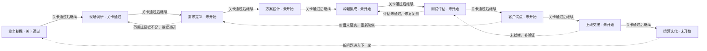
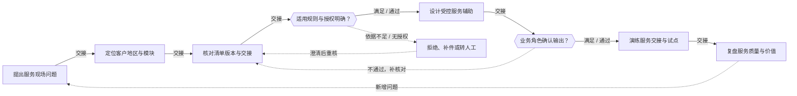
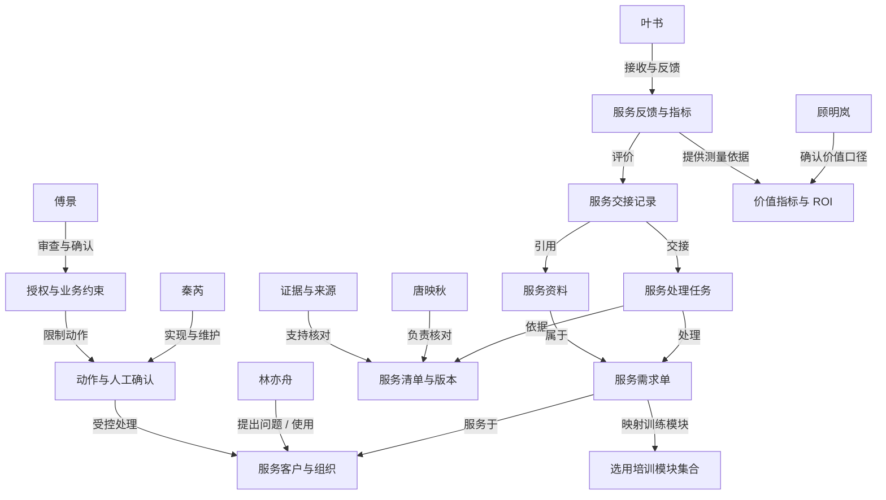

# 退货验收与售后协同 · 项目练习 1

## 当前实践模块

- 退货验收与售后协同（ecommerce-returns）

## 项目可选模块

- 退货验收与售后协同（ecommerce-returns）

## 模块已访谈证据（待核实）

- [ecommerce-returns / ecommerce-returns-f01] 顾明岚：当前主流程是：退货申请 → 寄回 → 仓库签收 → 商品验收 → 退款审批 → 客户通知。管理层还没有分别量出每个节点的等待和处理时间。
- [ecommerce-returns / ecommerce-returns-f00] 顾明岚：退货到退款平均 6 天，目标 3 天；状态催问占 42%，目标 20%
- [ecommerce-returns / ecommerce-returns-f11] 林亦舟：包裹有多个订单，退回件数量与申请不一致
- [ecommerce-returns / ecommerce-returns-f15] 林亦舟：建议必须显示对应原记录和待确认字段。发生“包裹有多个订单，退回件数量与申请不一致”时，我会暂停该建议，由售后工单员核对后继续，错误结果不能覆盖原记录。
- [ecommerce-returns / ecommerce-returns-f22] 唐映秋：我的岗位是售后工单员，可以整理、校核和发起复核；不能代替交易风险专员完成专业签核，也不能自行批准“售后状态解释与异常分派，不自主退款或处罚账号”以外操作。
- [ecommerce-returns / ecommerce-returns-f24] 唐映秋：与“退货验收与售后协同”相关规则由业务负责人维护，按生效日期和适用范围选版本。规则冲突时附两个版本给交易风险专员，不自行合并或选较宽松条款。
- [ecommerce-returns / ecommerce-returns-f30] 秦芮：我们正在使用OMS、WMS 和售后客服台，各系统账号权限独立维护，业务状态尚没有统一视图。
- [ecommerce-returns / ecommerce-returns-f41] 傅景：只有授权的业务岗位可以查看“退货申请、物流回执、开箱记录、质检结果和退款状态”。涉及最终决定、对外承诺或资产变更，要由对应审批人确认，不能借用其他人的账号。
- [ecommerce-returns / ecommerce-returns-f40] 傅景：退款和交易争议需授权人员审核，客户只能看本人订单
- [ecommerce-returns / ecommerce-returns-f44] 傅景：出现“包裹有多个订单，退回件数量与申请不一致”、资料缺少依据、两个版本冲突或关键系统不可用时转人工。需要标注触发原因、接手人和确认时间，不能只给一句模糊提醒。
- [ecommerce-returns / ecommerce-returns-f42] 傅景：一个品类试点，状态解释准确率 99%，未验收自动退款为零；同时检查“退款和交易争议需授权人员审核，客户只能看本人订单”。只要触及停止条件，就暂停试点并由负责人复盘。
- [ecommerce-returns / ecommerce-returns-f43] 傅景：试点原始资料按本场景授权范围保存；本轮评价记录暂保留 90 天，期满由交易风险专员复核删除或归档。真实期限仍须按组织规则另行确定。
- [ecommerce-returns / ecommerce-returns-f52] 叶书：售后状态解释与异常分派，不自主退款或处罚账号
- [ecommerce-returns / ecommerce-returns-f53] 叶书：客服按到仓算退货完成，仓库按验收完成，财务按退款到账。需要分别记录各岗完成时间，试点指标固定分母、排除规则和统计周期，不能把同一业务拆成多次“成功”提高比例。
- [ecommerce-returns / ecommerce-returns-f50] 叶书：客服按到仓算退货完成，仓库按验收完成，财务按退款到账
- [ecommerce-returns / ecommerce-returns-f51] 叶书：目前可用工作量基线是：每日 1500 个退货包裹，客服查询每次约 4 分钟。服务侧还会逐笔采集交接等待和重新联系次数，不能用发送通知数量代替实际完成量。
- [ecommerce-returns / ecommerce-returns-f54] 叶书：客户或下游反馈优先关联原业务编号和当时使用的资料版本，再查实际交接是否完成。争议由消费者服务主管受理、售后工单员核对，未经确认不承诺赔偿或结果。
- [ecommerce-returns / ecommerce-returns-f55] 叶书：试点每周收集 退货质检员、售后工单员、消费者服务主管 的误判例子和未解决问题，由售后运营经理确认改进负责人；先复测“一个品类试点，状态解释准确率 99%，未验收自动退款为零”，再更新规则版本。
- [ecommerce-returns / ecommerce-returns-f05] 顾明岚：售后状态解释与异常分派，不自主退款或处罚账号。首期采用历史资料回放，再做小范围并行试点，不直接替换现有业务。
- [ecommerce-returns / ecommerce-returns-f02] 顾明岚：一个品类试点，状态解释准确率 99%，未验收自动退款为零
- [ecommerce-returns / ecommerce-returns-f04] 顾明岚：立项由售后运营经理推动；交易风险专员可以因关键风险否决上线，消费者服务主管参与服务结果验收。
- [ecommerce-returns / ecommerce-returns-f03] 顾明岚：首期可用预算 15 万元，包含集成、培训与验证。收益要扣除维护及人工复核成本，不能把全部节省工时当作现金回款。
- [ecommerce-returns / ecommerce-returns-f34] 秦芮：本次试点计划每天两次更新已授权的业务状态，原始资料按版本更新；信息超过一个更新周期就标为待刷新，不能作为实时承诺。
- [ecommerce-returns / ecommerce-returns-f35] 秦芮：接口中断时继续使用带时间戳的上一份只读快照，并显示“暂未更新”。重连后按业务编号去重补齐，不反复触发同一待办；现有人工流程继续运行。
- [ecommerce-returns / ecommerce-returns-f33] 秦芮：先校验“退货申请、物流回执、开箱记录、质检结果和退款状态”里的主编号、事件时间和版本字段。包裹号与售后单号多对多，签收与验收被混用；有歧义的记录进入人工修复队列，不进入自动推荐样本。
- [ecommerce-returns / ecommerce-returns-f31] 秦芮：包裹号与售后单号多对多，签收与验收被混用
- [ecommerce-returns / ecommerce-returns-f32] 秦芮：可读订单与售后，不能自动退款或认定欺诈
- [ecommerce-returns / ecommerce-returns-f45] 傅景：每次建议保留业务编号、资料版本、事实引用、建议结果、人工改动和签核人。审计时应能重建“退货申请 → 寄回 → 仓库签收 → 商品验收 → 退款审批 → 客户通知”中的这次处理，不记录账号口令或不必要的个人信息。
- [ecommerce-returns / ecommerce-returns-f25] 唐映秋：异常先由售后工单员分派给实际处理人；超过约定时限再升级到售后运营经理。跨岗问题不能只写“已转交”，需要明确下一责任人。
- [ecommerce-returns / ecommerce-returns-f23] 唐映秋：交接至少包含业务编号、当前版本、处理状态、未解决事项和接手人。对方确认接手才结束本岗待办，仅发送消息不算完成。
- [ecommerce-returns / ecommerce-returns-f21] 唐映秋：退货申请、物流回执、开箱记录、质检结果和退款状态
- [ecommerce-returns / ecommerce-returns-f20] 唐映秋：退货申请 → 寄回 → 仓库签收 → 商品验收 → 退款审批 → 客户通知。我负责把每一步的输入、输出和待办责任人写清楚；退回原步骤必须保留原因。
- [ecommerce-returns / ecommerce-returns-f14] 林亦舟：因为“物流显示仓库签收，但质检尚未排到，客服无法解释等待”，同事经常把关键说明留在个人便签或群里，再补进正式记录；这些说明目前没有随单据交接。
- [ecommerce-returns / ecommerce-returns-f13] 林亦舟：现场执行围绕“退货验收与售后协同”。高峰期只能使用现有终端，离开业务现场去补录会延误处理；草稿应可暂存，并明确最后同步时间。
- [ecommerce-returns / ecommerce-returns-f12] 林亦舟：每日 1500 个退货包裹，客服查询每次约 4 分钟
- [ecommerce-returns / ecommerce-returns-f10] 林亦舟：物流显示仓库签收，但质检尚未排到，客服无法解释等待

# FDE 全流程训练记录

项目：退货验收与售后协同

训练者填写的任务和角色评审记录；不自动证明真实客户授权、生产上线或实际收益。

## 1. 业务挖掘

从经营目标、真实事件和指标基线中判断是否值得立项。

### 识别业务机会

交付：业务机会清单

状态：已完成 · 责任人：当前练习者

证据：当前练习访谈与案例资料

围绕“退货验收与售后协同”识别业务机会，核心仍是把客户提的手段“想用AI改善”与真正要改善的业务结果区分开——要改善的是退款时效的可预期性与可解释性，而非直接等于上AI；但本次修正的关键是把已获访谈事实逐条挂到机会清单，删除“六处均待访谈核实”的笼统表述。已获基线方面：顾明岚给出退货到退款平均6天、目标3天，状态催问占比42%、目标20%，首期范围、验收口径、预算15万与决策链；林亦舟给出多订单混装、退回件数量与申请不一致的异常、便签补录习惯、每日1500包裹与单次查询4分钟；秦芮给出三系统无统一视图、多对多与签收验收混用、只读接口边界；傅景给出四类兜底与未验收自动退款为零；叶书给出三种完成口径与投诉处理规则。触发事件候选明确为林亦舟所述“多订单混装、退回件数量与申请不一致”，订单号、发生时间、卡住时长、交接次数列为待补，不再笼统说“需锁定一单”。损失假设用量化口径重写：6天对3天的时间差构成时效损失区间，42%对20%的催问占比结合1500单×4分钟的查询工时构成返工与查询成本（需说明4分钟是否含跨岗核实），异常件暂停与二次核对构成复核成本，均注明为待样本验证。机会清单按证据强度重排：O1打通签收—质检—退款状态使客服可查可解释（依据秦芮三系统无统一视图与叶书催问42%，可验证验收假设为状态解释准确率99%、未验收自动退款为零，样本窗口待定）；O2缩短质检排队等待（依据顾明岚6天对3天与林亦舟1500单现场）；O3统一完成口径（已有叶书三种完成口径与唐映秋流程交接的直接依据，提升为有据机会）；O4明确退款前审批与兜底边界（已有傅景四类兜底与未验收自动退款为零的直接依据，同为有据机会）；O5用AI辅助质检分派维持弱证据，须待O1至O4基线后再判断；首期只做只读核对与人工交接、不碰执行。单列口径冲突与待核实事项：节点耗时是否已拆（顾明岚称未拆、林亦舟称查询4分钟属流程说明口径）、4分钟是否含跨岗核实、1500单中签收未质检占比未核实（叶书口径）、审批清单与升级时限、AI日志是否纳入留存。结论是当前处于识别机会起点，客户提的是手段要的是结果，首个可验证机会为低风险的O1，损失数字均为待样本验证的假设，权限与验收标准需与傅景、顾明岚、叶书交叉确认，下一步按请求表向六角色各取最近处理记录、补记来源版本样本时间窗权限与陈述差异，并补齐触发事件候选的订单号、时间、耗时与交接次数，再形成带基线的机会清单。

### 建立现状基线

交付：指标基线与价值假设

状态：已完成 · 责任人：当前练习者

证据：当前练习访谈与案例资料

围绕“退货验收与售后协同”建立现状基线，需按时效、返工、复核成本三类定义指标的分子、分母、时间窗、样本来源与测量责任人：时效类设“签收至质检完成时长”（分子为质检完成时间减签收时间，分母为该时间窗全部已签收退货单，时间窗取最近一个完整自然月，来源为OMS时间戳与质检记录，秦芮供数、林亦舟核对）、“质检完成至退款发起时长”（分母为同期质检通过单，来源为退款与工单系统，唐映秋供数、傅景核审批卡点）、“退款发起至到账时长”（分母为同期已退款单，叶书从客户侧验证）；返工类设“重复建单率”（分子为同一退货单重复创建或升级的工单数，分母为同期退货工单总数，唐映秋负责）与“质检二次复核率”（分子为被推翻或返工的质检单，分母为同期质检单，林亦舟记录、顾明岚定口径）；复核成本类设“单均人工核对工时”（分子为各环节人工查询核对工时合计，分母为同期处理单量，顾明岚负责）与“状态不明重复咨询量”（分子为追问退款进度的重复咨询工单，分母为同期售后咨询总量，叶书负责）；其中两段时长与重复建单率有系统时间戳可采集，单均工时、二次复核率与重复咨询量目前仅为角色口头估计、须列为待采集，全部指标的时间窗、脱敏范围和版本需访谈确认，样本验证前基线数字只能作为待验证的价值假设，不能写成既成结论。

### 确认立项与决策链

交付：项目章程与利益相关者地图

状态：已完成 · 责任人：当前练习者

证据：当前练习访谈与案例资料

围绕“退货验收与售后协同”的立项与决策链，按“项目章程＋利益相关者地图”两件套输出如下。项目章程：业务目标为退货到退款由平均6天缩短至3天、状态催问占比由42%降至20%（依据顾明岚f02）；首期范围限定为售后状态解释与异常分派，不自主退款、不处罚账号（f05）；验收标准为一个品类试点、状态解释准确率99%、未验收自动退款为零，与傅景“未验收自动退款为零”的红线一致（f02、傅景口径）；预算15万元，收益须扣除维护与人工复核成本（f03）；决策与否决方面，顾明岚推动立项并承担业务结果，傅景可否决上线、守风险红线，叶书参与服务结果验收（f04）；停止条件为触及红线即暂停并由负责人复盘。利益相关者地图按五层划分：发起人为售后运营经理顾明岚（已访谈，承担业务结果，事实编号f02、f03、f04、f05）；使用者为退货质检员林亦舟（已访谈，现场操作与异常处理，负责交接与现场执行）、售后工单员唐映秋（已访谈，流程交接与资料责任）、消费者服务主管叶书（已访谈，客户体验口径并参与服务结果验收）；出资者为顾明岚所代表的售后运营预算（15万元已确认），预算追加审批人待访谈；审批者与否决者为傅景（风险签核与可否决上线，已访谈），顾明岚为试点决策者；被影响者包括客服一线与客户侧体验，待补访谈。修正角色定位：秦芮为系统与数据集成条件的核实方，不是审批者，其只读接口边界属调查条件而非审批权。访谈授权与调查边界单列：只读核对、人工交接，合成训练不代表真实授权、业务执行或客户验收。尚未访谈或尚未核实项包括出资者与预算追加审批人、节点级耗时采集责任人、审批清单与各级审批人、转人工接手人按岗位还是按人、AI日志是否纳入留存与审计，以及节点耗时是否已拆、4分钟是否含跨岗核实、1500单中签收未质检占比等口径冲突。基线须挂靠“万象优选的一次具体事件”样本验证，触发事件候选为林亦舟所述多订单混装、退回件数量与申请不一致，订单号、发生时间、卡住时长、交接次数待补；未验证前不预设根因、预算追加或承诺收益。结论：业务结果由顾明岚承担，风险红线由傅景把关，服务结果验收由叶书参与，唐映秋与林亦舟承担交接与现场执行责任，秦芮仅提供系统与数据条件核实，所有权限、预算与最终验收权在访谈确认前一律记为待核实。

关卡：业务负责人确认问题、指标口径与调查范围

{"status":"通过","reviewer":"大模型任务评审","evidence":"opportunity-trigger：78分；opportunity-baseline：78分；opportunity-mandate：88分","decision":"三项任务均已完成模型评分并通过，已保存关卡评审，可导出报告并进入下一环节。","updatedAt":"2026-11-05T05:47:45.938Z"}

## 2. 现场调研

还原实际流程，用多角色和多来源材料核实问题。

### 开展角色访谈

交付：访谈记录与角色地图

状态：已完成 · 责任人：当前练习者

证据：当前练习访谈与案例资料

# 任务 1 / 3：开展角色访谈——访谈记录与角色地图（修正版）

## 一、逐角色访谈记录

**顾明岚 · 售后运营经理（业务负责人）**——已获事实：业务目标为退货到退款平均6天缩短至3天、状态催问占比42%降至20%；首期预算15万元，收益须扣维护与人工复核成本；立项由售后运营经理推动、傅景可否决上线、叶书参与服务结果验收；首期范围为售后状态解释与异常分派，不自主退款、不处罚账号。**待核实**：节点级耗时未拆开、无法判断瓶颈，需确认由谁采集、首期品类与历史回放时长、15万是否为硬上限。

**林亦舟 · 退货质检员（一线）**——已获事实：最近一单出现**多订单混装、退回件数量与申请不一致**（f11），需暂停质检、回查申请单、联系工单员确认后补录便签；每日约1500包裹，单次查询约4分钟；复核要求见f15。**待核实**：该单订单号、发生时间、卡住时长、交接次数；便签补录绕开系统的原因；4分钟是否含跨岗核实。

**唐映秋 · 售后工单员（一线交接）**——已获事实：接质检异常后建单、查申请记录、与客户或仓库核对再决定是否升级；交接字段已明确，**对方确认接手才算完成**；承担分派升级与材料责任。**待核实**：约定升级时限、责任转移的书面规则、转人工接手人按岗位还是按人。

**秦芮 · OMS工程师（系统）**——已获事实：OMS/WMS/客服台**三系统状态无统一视图**；包裹号与售后单号**多对多**；**签收与验收混用**；接口只读、不可自动退款；故障兜底方式已说明。**待核实**：状态字段口径与更新频率、脏数据处理方式、故障时人工兜底接手人。

**傅景 · 交易风险专员（风险）**——已获事实：**四类兜底触发**情形已明确；审计凭证字段已给出；**90天暂定留存**；可否决上线；**未验收自动退款为零**为红线。**待核实**：AI输出日志是否纳入留存与审计、各级审批人与审批清单。

**叶书 · 消费者服务主管（下游）**——已获事实：三种“完成”口径并存——客服按到仓、仓库按验收、财务按退款到账；投诉处理规则与反馈闭环已说明。**待核实**：1500单中签收未质检场景占比、三种口径如何统一。

## 二、角色地图

| 角色 | 定位 | 负责事项 | 关键证据 | 待核实 |
|---|---|---|---|---|
| 顾明岚 | 业务发起/结果承担 | 目标、预算、决策与试点范围 | f02–f05 | 节点耗时采集责任人、首期品类、15万是否硬上限 |
| 林亦舟 | 一线使用 | 质检异常与复核 | f11、f15 | 异常单订单号/时间/卡住时长/交接次数、4分钟口径 |
| 唐映秋 | 一线使用 | 工单交接、分派升级与材料 | 交接字段与接手确认规则 | 升级时限、接手人按岗位还是按人 |
| 秦芮 | 系统条件核实（非审批） | 系统、数据、接口与故障兜底 | 三系统无统一视图、多对多、签收验收混用、只读 | 字段口径、更新频率、脏数据处理 |
| 傅景 | 风险审批/否决 | 风险红线、审批、留存与审计 | 四类兜底、审计字段、90天留存、未验收自动退款为零 | AI日志是否纳入审计、审批清单 |
| 叶书 | 下游口径/服务验收 | 服务口径、投诉与反馈闭环 | 三种完成口径、投诉规则 | 1500单中签收未质检占比 |

## 三、矛盾陈述（单列）

1. **耗时口径**：6天对3天、42%对20%已获，但顾明岚称节点耗时未拆，无法定位瓶颈，与林亦舟4分钟查询口径需对齐。
2. **完成口径**：客服按到仓、仓库按验收、财务按退款到账，三者并存。
3. **数据口径**：包裹号与售后单号多对多、签收与验收混用，导致状态无法唯一对应。

## 四、待核实事项汇总

节点耗时由谁采集、首期品类与历史回放时长、1500单中签收未质检场景占比、4分钟是否含跨岗核实、约定升级时限、转人工接手人按岗位还是按人、AI输出日志是否纳入留存与审计、15万是否硬上限。

## 五、边界与我的理解

调查边界为**只读核对与人工交接**，AI只做状态解释与异常分派，不自主退款、不处罚账号，**未验收自动退款为零**。我的理解：本次访谈已形成六角色带证据编号的记录与角色地图，触发事件候选为f11多订单混装异常，但订单号、时间、卡住时长、交接次数仍待补，尚不能作为已验证基线；三类口径冲突（耗时、完成、数据）必须在取数前统一，否则6天对3天、42%对20%会被口径污染；审批与否决边界落在傅景与顾明岚，秦芮仅为系统条件核实方。下一步补齐f11待补项与上述待核实事项，再进入基线验证。

### 还原现状流程

交付：现状流程图与异常路径

状态：已完成 · 责任人：当前练习者

证据：当前练习访谈与案例资料

# 任务：还原现状流程——现状流程图与异常路径

## 一、现状流程图（以f11多订单混装异常单为样本）

```
[触发] 客户提交退货申请
   │  输入：售后单号、申请退货件数、订单信息
   ▼
[节点1] 物流到仓签收 ─────────────── 责任人：仓库收货岗（待访谈确认）
   │  输入：包裹号；系统：WMS/OMS
   │  输出：签收时间戳（与"验收"混用，秦芮f08）
   ▼
[节点2] 包裹进入待质检队列 ────────── 责任人：退货质检员 林亦舟
   │  输入：包裹号、售后单号（多对多，需人工匹配）
   │  系统：质检系统登记，异常靠便签补录
   ▼
[人工判断①] 拆包核对：件数/品类是否与申请一致？
   ├─ 一致 ──▶ [节点3] 登记质检通过 ──▶ 进入退款流程
   └─ 不一致（本单：多订单混装、退回件数量与申请不一致，f11）
          ▼
       [异常路径A] 暂停质检，回查申请单
          │  责任人：林亦舟；耗时：待补（卡住时长未记录）
          ▼
       [节点4] 交接售后工单员 唐映秋 ── 责任人：唐映秋
          │  交接规则：对方确认接手才算完成
          │  输入：异常说明+便签；系统：工单系统
          ▼
       [人工判断②] 建单后核对：与客户/仓库确认件数差异
          ├─ 可确认 ──▶ 回退质检重核（返工点）
          └─ 不可确认 ──▶ 升级/转人工（升级时限待核实）
          ▼
       [节点5] 质检重核 ── 责任人：林亦舟（二次复核，f15）
          ▼
       [节点6] 质检通过 → 退款发起 ── 责任人：待访谈确认（审批卡点在傅景，f09）
          │  红线：未验收自动退款为零
          ▼
       [输出] 退款到账 ── 客户侧口径（叶书三种完成口径之一）
```

## 二、理想流程与现场做法的差异

| 环节 | 理想流程 | 现场做法 | 差异性质 |
|---|---|---|---|
| 签收与验收 | 签收、验收分状态记录 | 两者混用（秦芮f08） | 数据口径问题 |
| 包裹与售后单匹配 | 包裹号与售后单号一一对应 | 多对多，需人工匹配 | 系统关系问题 |
| 异常记录 | 系统内结构化登记 | 便签补录，绕开系统 | 现场习惯，原因待核实 |
| 交接 | 系统内交接、责任自动转移 | 对方确认接手才算完成（唐映秋） | 规则差异 |
| 状态查询 | 统一视图可查 | OMS/WMS/客服台三系统无统一视图（秦芮f08） | 系统集成缺失 |

## 三、哪些判断只能由人完成

1. **件数与品类一致性判断**（人工判断①）：多订单混装时需拆包核对实物，系统无法自动判定，只能由林亦舟完成。
2. **件数差异的责任归属判断**（人工判断②）：需与客户/仓库交叉确认，涉及责任划分，只能由唐映秋完成。
3. **是否升级、是否转人工的判断**：涉及风险与客户体验权衡，升级时限待核实，不能自动化。
4. **退款前审批**：傅景四类兜底触发需人工签核，未验收自动退款为零为红线，AI不得自主退款。
5. **完成口径的选择**：客服按到仓、仓库按验收、财务按退款到账，三口径并存，需人来裁定以哪个为准。

## 四、瓶颈标注与责任人

| 瓶颈 | 表现 | 责任人 | 证据 |
|---|---|---|---|
| 签收→质检排队 | 物流已签收、质检未排到，客服无法解释 | 仓库收货岗→林亦舟（交接点责任待明确） | 客户简报、f08 |
| 异常暂停 | 多订单混装需暂停回查，卡住时长未记录 | 林亦舟 | f11 |
| 人工匹配多对多 | 包裹号与售后单号多对多，需人工对应 | 秦芮（系统条件） | f08 |
| 交接确认 | 对方确认接手才算完成，交接等待 | 唐映秋 | 交接规则 |
| 二次复核 | 异常件回退重核 | 林亦舟 | f15 |
| 审批卡点 | 退款前人工审批 | 傅景 | f09 |
| 口径不一 | 三种完成口径并存 | 叶书 | f10 |

## 五、我的理解与结论

现状流程的核心断点不在单点效率，而在**交接与口径**：签收与验收混用、包裹号与售后单号多对多、三系统无统一视图，导致"已签收未质检"状态无法被唯一识别和解释；异常路径上，多订单混装（f11）触发暂停与回查，但卡住时长、交接次数均无记录，返工成本无法量化。理想流程与现场做法的差异集中在数据口径与系统集成，而件数一致性、责任归属、升级决策、退款审批、完成口径这五类判断只能由人完成，这与"只读核对与人工交接、不自主退款、不处罚账号"的边界一致。瓶颈责任人已标注，但仓库收货岗、退款发起岗尚未访谈，属待补；下一步应补齐f11的订单号、发生时间、卡住时长与交接次数，并确认节点耗时采集责任人，才能把流程断点转化为可验证的时效与返工基线。

### 四来源收敛与材料核对

交付：四来源收敛表、证据台账与问题清单

状态：已完成 · 责任人：当前练习者

证据：当前练习访谈与案例资料

# 任务 3 / 3：四来源收敛与材料核对——收敛表、证据台账与问题清单

## 一、四来源收敛表

| 维度 | 来源 | 核心陈述 | 证据编号 | 与其他来源的一致/分歧 | 核实材料与状态 |
|---|---|---|---|---|---|
| Buyer业务目标 | 顾明岚（售后运营经理） | 退货到退款6天→3天；状态催问42%→20%；预算15万；傅景可否决上线、叶书参与服务结果验收 | f02–f05 | 与Brief范围一致；与Operator现场"节点耗时未拆"分歧——目标有数但无法定位瓶颈 | 制度/目标文件待索；**部分待核** |
| Brief书面范围 | 客户简报 | 只读核对与人工交接；不预设根因、预算或承诺收益；基线按样本验证 | 客户简报 | 与Buyer的15万预算、3天目标存在张力：Brief不承诺收益，Buyer已给目标值 | 简报原文已核；**一致** |
| Industry技术可行性 | 秦芮（OMS工程师） | 三系统无统一视图；包裹号与售后单号多对多；签收与验收混用；接口只读、不可自动退款 | f08 | 与Buyer"状态解释"目标一致但技术上只能只读；与Operator便签补录互相印证系统不足 | 接口清单、字段字典待索；**部分待核** |
| Operator现场故障 | 林亦舟、唐映秋、叶书 | 多订单混装件数不符（f11）；二次复核（f15）；便签补录；对方确认接手才算完成；三种完成口径 | f11、f15、f10 | 与Industry"多对多、签收验收混用"吻合；与Buyer"6天"分歧在节点耗时未拆、4分钟是否含跨岗核实 | 异常单订单号/时间/卡住时长/交接次数待补；**待核** |

**收敛结论**：四来源在"系统无统一视图、状态不可解释"上高度一致；分歧集中在三处——①Buyer给了6天/42%目标但Operator称节点耗时未拆，目标值缺节点级支撑；②Brief不承诺收益而Buyer已列15万预算与3天目标，需确认预算与目标是否已获正式授权；③Industry只读接口与Operator便签补录均说明现状绕开系统，但绕开原因未记录。

## 二、证据台账

| 编号 | 陈述 | 来源人 | 材料类型 | 时间窗 | 版本 | 样本口径 | 状态 |
|---|---|---|---|---|---|---|---|
| f02 | 6天→3天、42%→20% | 顾明岚 | 目标陈述 | 待补 | 待补 | 未说明样本量 | 已获陈述，**待材料核** |
| f03 | 预算15万，收益扣维护与复核成本 | 顾明岚 | 预算陈述 | 待补 | 待补 | 未说明是否硬上限 | 已获陈述，**待制度核** |
| f04 | 顾推动、傅否决、叶验收 | 顾明岚 | 决策链陈述 | 待补 | 待补 | 待审批清单核 | 已获陈述，**待核** |
| f05 | 首期范围：状态解释与异常分派，不自主退款 | 顾明岚 | 范围陈述 | 待补 | 待补 | 待品类确认 | 已获陈述，**部分核** |
| f08 | 三系统无统一视图、多对多、签收验收混用、只读 | 秦芮 | 系统陈述 | 待补 | 待补 | 待字段字典 | 已获陈述，**待日志/接口核** |
| f09 | 四类兜底、审计字段、90天留存、未验收自动退款为零 | 傅景 | 风险陈述 | 90天暂定 | 待补 | 待审批清单 | 已获陈述，**待制度核** |
| f10 | 三种完成口径、投诉规则 | 叶书 | 口径陈述 | 待补 | 待补 | 1500单占比未核 | 已获陈述，**待核** |
| f11 | 多订单混装、件数不符 | 林亦舟 | 异常事件 | 待补 | 待补 | 单样本 | **待补订单号/时间/卡住时长/交接次数** |
| f15 | 二次复核要求 | 林亦舟 | 操作规则 | 待补 | 待补 | 待样本 | 已获陈述，**待核** |

## 三、问题清单（按优先级）

1. **目标值缺节点支撑**：6天/42%是否有节点级耗时记录？由谁采集？4分钟是否含跨岗核实？（顾明岚vs林亦舟）
2. **预算与目标授权**：15万是否硬上限？3天目标是否已获正式授权，与Brief"不承诺收益"如何对齐？
3. **审批清单**：傅景的各级审批人、升级时限、转人工接手人按岗位还是按人？
4. **留存与审计**：AI输出日志是否纳入90天留存与审计凭证？
5. **口径统一**：三种完成口径以哪个为准？1500单中签收未质检占比多少？
6. **异常样本待补**：f11的订单号、发生时间、卡住时长、交接次数、便签原件。
7. **系统字段**：状态字段口径、更新频率、脏数据处理方式、接口只读清单。
8. **便签补录原因**：为何绕开系统，是系统不可用还是习惯？

## 四、我的理解与结论

四来源收敛显示，Buyer目标与Operator现场之间最大的裂缝是"目标有数、节点无数"——6天对3天、42%对20%目前只有陈述、没有节点级日志支撑，因此不能直接作为已验证基线；Brief明确不承诺收益，而Buyer已列15万预算与3天目标，二者需在正式授权层面确认，否则章程里的预算与验收标准缺乏依据。Industry与Operator在"系统无统一视图、便签补录、多对多匹配"上互相印证，说明现状断点是真实的，但绕开系统的原因未记录，不能预设为系统缺陷。证据台账中f11是唯一的具体异常样本，却仍缺订单号、时间、卡住时长与交接次数，是当前最该优先补齐的一项。结论：四来源已可收敛出"状态不可解释、口径不一、系统只读"三条共识，分歧保留在目标值支撑、预算授权与节点耗时三处；下一步按问题清单优先补齐f11样本与节点耗时采集责任人，再用制度、日志、单据、观察四类材料逐条核实，未核实前不将任何数字写入基线。

关卡：关键流程、异常、证据矛盾和待核实项已形成记录

{"status":"通过","reviewer":"大模型任务评审","evidence":"discovery-interviews：78分；discovery-process：78分；discovery-evidence：72分","decision":"三项任务均已完成模型评分并通过，已保存关卡评审，可导出报告并进入下一环节。","updatedAt":"2026-11-05T05:50:54.908Z"}

## 3. 需求定义

把调查发现收敛为有证据、可验收、可追责的需求。

### 确定优先问题

交付：问题优先级与机会判断

状态：未开始 · 责任人：当前练习者

证据：当前练习访谈与案例资料

尚无训练记录

### 编写需求与边界

交付：需求规格与追溯矩阵

状态：未开始 · 责任人：当前练习者

证据：当前练习访谈与案例资料

尚无训练记录

### 约定验收标准

交付：验收清单与需求确认记录

状态：未开始 · 责任人：当前练习者

证据：当前练习访谈与案例资料

尚无训练记录

关卡：问题优先级、需求范围和可测验收条件均有确认记录

{"status":"待确认"}

## 4. 方案设计

以最小试点验证价值，设计数据、系统和人工控制。

### 选定最小试点

交付：试点方案与方案比较

状态：未开始 · 责任人：未填写

证据：未填写

尚无训练记录

### 设计数据和系统边界

交付：架构图、数据与权限矩阵

状态：未开始 · 责任人：未填写

证据：未填写

尚无训练记录

### 报价与投入产出测算

交付：项目报价、首年ROI测算与实施评估计划

状态：未开始 · 责任人：未填写

证据：未填写

尚无训练记录

关卡：试点边界、方案取舍、数据权限与实施计划已评审

{"status":"待确认"}

## 5. 构建集成

实现可运行的最小闭环，使规则、模型与人工责任可追溯。

### 落实数据与工具契约

交付：数据契约与集成记录

状态：未开始 · 责任人：未填写

证据：未填写

尚无训练记录

### 实现业务闭环

交付：原型代码与版本说明

状态：未开始 · 责任人：未填写

证据：未填写

尚无训练记录

### 实现异常与审计

交付：异常处理与审计样例

状态：未开始 · 责任人：未填写

证据：未填写

尚无训练记录

关卡：指定版本可复现运行，异常和人工交接路径完整

{"status":"待确认"}

## 6. 测试评估

证明行为与需求一致，区分模拟验证、真实模型验证与业务验收。

### 建立评估集合

交付：评估集与需求覆盖表

状态：未开始 · 责任人：未填写

证据：未填写

尚无训练记录

### 执行测试与重复评估

交付：测试报告与评估结果

状态：未开始 · 责任人：未填写

证据：未填写

尚无训练记录

### 修复并回归确认

交付：缺陷闭环与质量结论

状态：未开始 · 责任人：未填写

证据：未填写

尚无训练记录

关卡：评估范围、版本、失败项、修复复测与剩余风险可审查

{"status":"待确认"}

## 7. 客户试点

在受控范围中验证实际采用和业务收益。

### 准备受控试点

交付：试点执行计划

状态：未开始 · 责任人：未填写

证据：未填写

尚无训练记录

### 开展用户验收

交付：用户验收与反馈记录

状态：未开始 · 责任人：未填写

证据：未填写

尚无训练记录

### 核对价值与继续决定

交付：试点收益复核与决策纪要

状态：未开始 · 责任人：未填写

证据：未填写

尚无训练记录

关卡：试点对照、用户反馈、退出条件与扩大范围决定有记录

{"status":"待确认"}

## 8. 上线交接

把通过试点的版本交给具名负责人，明确上线和回退责任。

### 审查上线准备

交付：上线准备检查与三方评审

状态：未开始 · 责任人：未填写

证据：未填写

尚无训练记录

### 演练发布与回滚

交付：发布计划与回滚演练记录

状态：未开始 · 责任人：未填写

证据：未填写

尚无训练记录

### 完成运维和用户交接

交付：交接清单、运行手册与签收记录

状态：未开始 · 责任人：未填写

证据：未填写

尚无训练记录

关卡：业务、技术和风险角色的上线准备及交接决定有依据

{"status":"待确认"}

## 9. 运营迭代

持续观察价值、质量和成本，形成下一轮业务发现。

### 建立持续运营节奏

交付：30/60/90天运营计划

状态：未开始 · 责任人：未填写

证据：未填写

尚无训练记录

### 演练事件与变更管理

交付：事件复盘与变更记录

状态：未开始 · 责任人：未填写

证据：未填写

尚无训练记录

### 复盘并启动下一轮发现

交付：项目复盘、迭代清单与作品集

状态：未开始 · 责任人：未填写

证据：未填写

尚无训练记录

关卡：运营节奏、事件闭环、复盘及下一轮优先级已确认

{"status":"待确认"}


# FDE阶段成果与追溯

项目：退货验收与售后协同
练习：282b8cb0-162b-4f94-859b-6ec5d2a9a204

- 报告 REPORT-4583e2da-5571-4728-aa3b-e0ce48335d86 v3：万象优选 · 业务需求发现报告

## 业务挖掘 · stale

成果：ART-e8364c12-6b36-4421-a0c7-744d7a90a62e v1

输入：REPORT-0569949f-981e-42c8-af06-c621d82fe117 v1

围绕退货验收与售后协同整理业务挖掘。以下为基于已保存输入的待完善草稿。

### 业务机会清单

上游输入：万象优选 · 业务需求发现报告 v1：现有事实显示，退货链路从签收到退款存在多系统状态分散、节点耗时未拆分、异常需人工复核、退款与争议须授权审核等约束。管理层目标（6天降至3天、催问42%降至20%）与验收硬约束（状态解释准确率99%、未验收自动退款为零）已明确，但瓶颈定位、试点范围、审批清单、转人工接手方式与留存口径均未核实。当前证据足以形成若干待验证需求假设，但不足以判定优先环节或验收通过；调查覆盖率12/36，仅代表已采集事实范围，不代表验收结论。

本步整理：收集最近一次异常事件，区分客户提出的功能和真正要改善的业务结果。

待明确：哪个具体事件触发了需求？如果维持现状，会产生什么损失？
边界：只读核对与人工交接；合成训练不代表真实授权、业务执行或客户验收

引用：ecommerce-returns-f01、ecommerce-returns-f00、ecommerce-returns-f30、ecommerce-returns-f11、ecommerce-returns-f15、ecommerce-returns-f22、ecommerce-returns-f40、ecommerce-returns-f41、ecommerce-returns-f42、ecommerce-returns-f44、ecommerce-returns-f24、ecommerce-returns-f43

### 指标基线与价值假设

上游输入：万象优选 · 业务需求发现报告 v1：现有事实显示，退货链路从签收到退款存在多系统状态分散、节点耗时未拆分、异常需人工复核、退款与争议须授权审核等约束。管理层目标（6天降至3天、催问42%降至20%）与验收硬约束（状态解释准确率99%、未验收自动退款为零）已明确，但瓶颈定位、试点范围、审批清单、转人工接手方式与留存口径均未核实。当前证据足以形成若干待验证需求假设，但不足以判定优先环节或验收通过；调查覆盖率12/36，仅代表已采集事实范围，不代表验收结论。

本步整理：定义指标分子、分母、时间窗、样本来源和测量责任人，缺失数据列为待采集。

待明确：现状耗时、返工和错误如何计算？哪些数字还只是估计？
边界：只读核对与人工交接；合成训练不代表真实授权、业务执行或客户验收

引用：ecommerce-returns-f01、ecommerce-returns-f00、ecommerce-returns-f30、ecommerce-returns-f11、ecommerce-returns-f15、ecommerce-returns-f22、ecommerce-returns-f40、ecommerce-returns-f41、ecommerce-returns-f42、ecommerce-returns-f44、ecommerce-returns-f24、ecommerce-returns-f43

### 项目章程与利益相关者地图

上游输入：万象优选 · 业务需求发现报告 v1：现有事实显示，退货链路从签收到退款存在多系统状态分散、节点耗时未拆分、异常需人工复核、退款与争议须授权审核等约束。管理层目标（6天降至3天、催问42%降至20%）与验收硬约束（状态解释准确率99%、未验收自动退款为零）已明确，但瓶颈定位、试点范围、审批清单、转人工接手方式与留存口径均未核实。当前证据足以形成若干待验证需求假设，但不足以判定优先环节或验收通过；调查覆盖率12/36，仅代表已采集事实范围，不代表验收结论。

本步整理：明确业务发起人、使用者、出资者、审批者，记录访谈授权与调查边界。

待明确：谁承担结果？谁批准范围、数据访问及继续或停止？
边界：只读核对与人工交接；合成训练不代表真实授权、业务执行或客户验收

引用：ecommerce-returns-f01、ecommerce-returns-f00、ecommerce-returns-f30、ecommerce-returns-f11、ecommerce-returns-f15、ecommerce-returns-f22、ecommerce-returns-f40、ecommerce-returns-f41、ecommerce-returns-f42、ecommerce-returns-f44、ecommerce-returns-f24、ecommerce-returns-f43

需求：
- REQ-1 先补节点级耗时口径，再定试点优先环节；负责人售后运营经理（顾明岚）与OMS工程师（秦芮）共同确认；验收由顾明岚牵头、秦芮配合，按六节点定义耗时采集口径与数据来源，取一个品类近30天样本试算；人工确认点：顾明岚确认口径与试点品类，秦芮确认数据可取得性。；依据ecommerce-returns-f01、ecommerce-returns-f00
- REQ-2 签收后至验收前的状态解释是催问高发的候选瓶颈；负责人消费者服务主管（叶书）与售后工单员（唐映秋）；验收抽取催问工单按所处节点分类统计，验证签收至验收区间占比；人工确认点：叶书确认工单分类口径，顾明岚确认是否作为试点范围。；依据ecommerce-returns-f30、ecommerce-returns-f00
- REQ-3 异常场景只做提示与待确认字段，不输出处理结论；负责人退货质检员（林亦舟）与售后工单员（唐映秋）；验收以历史多订单混装样本做离线提示原型，检查是否仅呈现原记录与待确认字段；人工确认点：林亦舟确认可用性，唐映秋确认复核发起流程不变。；依据ecommerce-returns-f11、ecommerce-returns-f15、ecommerce-returns-f22
- REQ-4 退款与争议环节保持人工签核，AI不触及结论；负责人交易风险专员（傅景）；验收在试点方案中书面列明AI可输出与禁止输出清单，并设计审计留痕；人工确认点：傅景签字确认审批链与留痕设计后方可启动试点。；依据ecommerce-returns-f40、ecommerce-returns-f41、ecommerce-returns-f42
- REQ-5 四类兜底触发须带原因、接手人与确认时间转人工；负责人交易风险专员（傅景）与售后工单员（唐映秋）；验收与傅景、唐映秋确认接手人指定方式与系统不可用兜底通道，形成书面转人工清单；人工确认点：傅景确认审核边界守得住后再纳入试点。；依据ecommerce-returns-f44、ecommerce-returns-f24
- REQ-6 AI输出日志是否纳入留存范围需单列确认；负责人交易风险专员（傅景）；验收在试点方案中单列AI输出日志的留存与删除规则，待组织规则明确后由傅景复核；人工确认点：傅景确认留存口径与归档去向。；依据ecommerce-returns-f43


遗留项：书面Brief、行业可行性与现场测量是否已经核对？；本阶段责任人应补齐具体决定、执行证据与未解决事项。

确认：{"status":"待确认"}

## 现场调研 · missing

待生成；输入不足时先返回上游补齐。

## 需求定义 · missing

待生成；输入不足时先返回上游补齐。

## 方案设计 · missing

待生成；输入不足时先返回上游补齐。

## 构建集成 · missing

待生成；输入不足时先返回上游补齐。

## 测试评估 · missing

待生成；输入不足时先返回上游补齐。

## 客户试点 · missing

待生成；输入不足时先返回上游补齐。

## 上线交接 · missing

待生成；输入不足时先返回上游补齐。

## 运营迭代 · missing

待生成；输入不足时先返回上游补齐。

## 需求如何归纳

先从已采集事实形成问题假设，再约定业务结果、范围、失败控制和验收。缺少的来源标记待补，不能把六人访谈完整率当作四来源收敛或需求确认。

### 业务流程拆解

要回答：问题发生在哪一步，为什么要这样划分智能体？

1. 先画人工现状泳道，写出触发、输入、8–15个处理步骤、交接和异常。
2. 区分判断点与执行点；按使用的数据、权限、模型能力与失败方式组合执行步骤。
3. 在不可逆动作前设置确定性校验；为低置信、缺资料、冲突和越权安排具名人工接收人。

交付链：现状流程 → 失败方式 → 智能体/工具边界 → 校验与人工升级路径

原文：frameworks/workflow-decomposition.md

### 业务结果与不可逆风险矩阵

要回答：多个需求中，先做哪个最小可验证方案？

1. 列出3–5个候选切入点，分别说明改善的业务结果、现状基线和投入。
2. 评估失败何时被谁看见、能否在损害前拦截、是否可以撤销；不要把模型置信度等同于业务风险。
3. 优先选择高价值、可拦截且可恢复的切入点；高风险需硬约束和责任人否决权，价值或风险未知先补证据。

交付链：候选方案 → 价值/风险比较 → 选择与暂缓理由 → 验收指标与停止条件

原文：frameworks/outcome-risk-matrix.md

### 四来源收敛

要回答：谁说要做，哪里真的坏了，范围允许什么，技术是否可行？

1. Buyer：核实业务目标、预算、优先级和决定权；Operator：用最近一单还原真实操作和失败位置。
2. Brief：核对书面目标、范围、时间和排除项；Industry：寻找可比技术实践，并核实本项目的数据与接口差异。
3. 检查四个视角是否指向同一瓶颈。分歧保留在问题清单：一线帮助定位故障，决策者确认价值，Brief约束范围，行业证据帮助判断可行性。

交付链：四视角陈述与来源 → 收敛/分歧 → 待核实问题 → 有边界的需求假设

原文：frameworks/4-source-convergence.md

### 本次四来源核对

- Buyer · 业务决策者：顾明岚
  状态：已采集角色陈述，目标和预算仍待确认；已采集依据：ecommerce-returns-f01、ecommerce-returns-f00、ecommerce-returns-f05、ecommerce-returns-f02、ecommerce-returns-f04、ecommerce-returns-f03
- Brief · 书面需求：我们在“退货验收与售后协同”上投入了很多人力。物流显示仓库签收，但质检尚未排到，客服无法解释等待。管理层希望用 AI 改善，但还没有确定优先环节、验收标准和权限边界。请你先和各岗位聊聊，找出值得验证的业务需求。
  状态：当前只有场景开场；书面Brief原文与版本待补；已采集依据：暂无
- Industry · 行业可行性：需要可比技术案例、数据条件和接口能力的核验材料。企业业务介绍不能证明技术可行。
  状态：待补行业实践与本项目适用性验证；已采集依据：暂无
- Operator · 一线使用者：林亦舟
  状态：已采集现场陈述，仍需样本与操作观察核实；已采集依据：ecommerce-returns-f11、ecommerce-returns-f15、ecommerce-returns-f14、ecommerce-returns-f13、ecommerce-returns-f12、ecommerce-returns-f10

### 从证据到候选需求

- REQ-1 签收后等待期缺乏统一状态视图，是催问与查询负担的主因
  依据：ecommerce-returns-f10、ecommerce-returns-f14、ecommerce-returns-f30、ecommerce-returns-f31、ecommerce-returns-f01
  推导：事实显示物流签收但质检未排到时客服无法解释等待（f10），同事把说明留在便签或群里且不随单据交接（f14），OMS/WMS/客服台状态无统一视图（f30），签收与验收被混用（f31）。这些共同支持“可见性缺口”假设，但各节点等待时间尚未分别量出（f01），无法量化改善幅度。
  判断：候选需求；需用结果与不可逆风险矩阵比较，P0/P1/P2不等于已完成价值风险评分。
  下一步：先在一个品类抽取历史退货单，按“签收→验收→审批→通知”分别记录时间戳与等待时长，形成基线；再验证状态解释准确率是否可达99%。人工确认点：顾明岚确认统计分母与周期，秦芮确认数据源可读性。
- REQ-2 状态解释与异常分派可作为首期AI边界，不触碰退款与账号处罚
  依据：ecommerce-returns-f52、ecommerce-returns-f32、ecommerce-returns-f40、ecommerce-returns-f02
  推导：业务边界明确为“售后状态解释与异常分派，不自主退款或处罚账号”（f52），接口仅可读订单与售后、不能自动退款或认定欺诈（f32），退款与争议需授权人员审核（f40）。这支持把首期范围限定在解释与分派，但“状态解释准确率99%”的判定样本与标注规则尚未定义。
  判断：候选需求；需用结果与不可逆风险矩阵比较，P0/P1/P2不等于已完成价值风险评分。
  下一步：用历史资料回放（f05）构造解释样本集，由叶书与唐映秋共同标注“正确解释”标准；统计准确率并检查是否出现未验收自动退款。人工确认点：傅景对任何触及退款/处罚的输出行使否决。
- REQ-3 异常件（多订单混装、数量不符）需强制人工复核，AI只提示不一致与待确认字段
  依据：ecommerce-returns-f11、ecommerce-returns-f15、ecommerce-returns-f44
  推导：多订单混装、退回件数量与申请不一致是已知异常（f11），质检员要求建议显示原记录与待确认字段、异常时暂停并由工单员核对、错误结果不能覆盖原记录（f15），兜底规则要求标注触发原因、接手人和确认时间（f44）。这支持“提示而非结论”的设计，但人工修复队列的责任人与时限尚未核实。
  判断：候选需求；需用结果与不可逆风险矩阵比较，P0/P1/P2不等于已完成价值风险评分。
  下一步：选取含多订单混装的历史异常单做回放，验证系统能否带出业务编号、版本、待确认字段并正确转人工；记录误分派率。人工确认点：唐映秋确认分派字段完整性，顾明岚确认升级时限。
- REQ-4 交接闭环（确认接手才算完成）是缩短等待的关键控制点
  依据：ecommerce-returns-f23、ecommerce-returns-f25、ecommerce-returns-f20
  推导：交接需含业务编号、版本、状态、未解决事项和接手人，对方确认接手才结束待办，仅发消息不算完成（f23）；异常先由工单员分派、超时升级到运营经理，跨岗须写明下一责任人（f25）。这支持把“确认接手”作为可度量节点，但“约定时限”具体数值尚未核实。
  判断：候选需求；需用结果与不可逆风险矩阵比较，P0/P1/P2不等于已完成价值风险评分。
  下一步：在试点品类记录每次交接的发起时间、确认接手时间与超时次数，验证交接可见性是否降低重复联系；由顾明岚设定试点时限。人工确认点：唐映秋确认待办结束判定规则。
- REQ-5 各岗完成口径不一致会扭曲试点指标，须先固定分母与排除规则
  依据：ecommerce-returns-f50、ecommerce-returns-f53、ecommerce-returns-f51、ecommerce-returns-f12
  推导：客服按到仓、仓库按验收、财务按退款到账算完成（f50），需分别记录各岗完成时间、固定分母与排除规则、不能拆成多次成功（f53）；现有基线为每日1500包裹、查询约4分钟（f51），但质检员指出该口径非自采样本、异常单占比未核实（f12）。这支持“先定口径再验收”的假设。
  判断：候选需求；需用结果与不可逆风险矩阵比较，P0/P1/P2不等于已完成价值风险评分。
  下一步：由叶书与顾明岚共同出具指标定义单（分母、排除规则、统计周期），用一周历史数据试算；对比不同口径下催问率差异。人工确认点：顾明岚签字确认口径后方可进入试点验收。
- REQ-6 审计留痕与数据质量隔离是上线前置条件
  依据：ecommerce-returns-f45、ecommerce-returns-f33、ecommerce-returns-f35、ecommerce-returns-f43
  推导：每次建议须保留业务编号、资料版本、事实引用、建议结果、人工改动和签核人，且不记录口令与不必要个人信息（f45）；有歧义记录进入人工修复队列、不进入自动推荐样本（f33）；接口中断用带时间戳只读快照并标“暂未更新”（f35）。这支持把留痕与隔离作为前置门槛，但AI中间日志是否纳入审计、改动是覆盖还是留版本尚未核实。
  判断：候选需求；需用结果与不可逆风险矩阵比较，P0/P1/P2不等于已完成价值风险评分。
  下一步：在回放环境验证一条完整链路能否被重建（含人工改动与签核人），并测试接口中断场景；由傅景确认留存期限与AI日志口径。人工确认点：傅景对审计可还原性签字，未通过则暂停试点。


## Demo执行证据

尚未执行绑定Demo评估。

## 阶段练习与训练评分


## 历史版本

保留2个旧版本。JSON导出包含原始报告、成果版本和完整输入引用。


# 退货验收与售后协同 · ROI测算

尚未保存ROI测算。


# 退货验收与售后协同 · FDE业务流程与Ontology

练习：项目练习 1

阶段进度与关卡来自本次练习；业务流程与对象关系为建模定义，不代表实际业务已经执行。

对象生命周期：服务任务：提出 → 待核实 → 待确认 → 已交接；未结项继续跟踪

选用模块：
- 退货验收与售后协同（ecommerce-returns）

## FDE 项目处理流程

九阶段主线、阶段关卡和返工路径。完成与通过状态来自本次练习记录。



### 业务挖掘 · FDE阶段

从经营目标、真实事件和指标基线中判断是否值得立项。

关联阶段：业务挖掘

本次状态：关卡通过 · 3/3项任务

关卡：业务负责人确认问题、指标口径与调查范围

- 业务机会清单
- 指标基线与价值假设
- 项目章程与利益相关者地图

### 现场调研 · FDE阶段

还原实际流程，用多角色和多来源材料核实问题。

关联阶段：现场调研

本次状态：关卡通过 · 3/3项任务

关卡：关键流程、异常、证据矛盾和待核实项已形成记录

- 访谈记录与角色地图
- 现状流程图与异常路径
- 四来源收敛表、证据台账与问题清单

### 需求定义 · FDE阶段

把调查发现收敛为有证据、可验收、可追责的需求。

关联阶段：需求定义

本次状态：未开始 · 0/3项任务

关卡：问题优先级、需求范围和可测验收条件均有确认记录

- 问题优先级与机会判断
- 需求规格与追溯矩阵
- 验收清单与需求确认记录

### 方案设计 · FDE阶段

以最小试点验证价值，设计数据、系统和人工控制。

关联阶段：方案设计

本次状态：未开始 · 0/3项任务

关卡：试点边界、方案取舍、数据权限与实施计划已评审

- 试点方案与方案比较
- 架构图、数据与权限矩阵
- 项目报价、首年ROI测算与实施评估计划

### 构建集成 · FDE阶段

实现可运行的最小闭环，使规则、模型与人工责任可追溯。

关联阶段：构建集成

本次状态：未开始 · 0/3项任务

关卡：指定版本可复现运行，异常和人工交接路径完整

- 数据契约与集成记录
- 原型代码与版本说明
- 异常处理与审计样例

### 测试评估 · FDE阶段

证明行为与需求一致，区分模拟验证、真实模型验证与业务验收。

关联阶段：测试评估

本次状态：未开始 · 0/3项任务

关卡：评估范围、版本、失败项、修复复测与剩余风险可审查

- 评估集与需求覆盖表
- 测试报告与评估结果
- 缺陷闭环与质量结论

### 客户试点 · FDE阶段

在受控范围中验证实际采用和业务收益。

关联阶段：客户试点

本次状态：未开始 · 0/3项任务

关卡：试点对照、用户反馈、退出条件与扩大范围决定有记录

- 试点执行计划
- 用户验收与反馈记录
- 试点收益复核与决策纪要

### 上线交接 · FDE阶段

把通过试点的版本交给具名负责人，明确上线和回退责任。

关联阶段：上线交接

本次状态：未开始 · 0/3项任务

关卡：业务、技术和风险角色的上线准备及交接决定有依据

- 上线准备检查与三方评审
- 发布计划与回滚演练记录
- 交接清单、运行手册与签收记录

### 运营迭代 · FDE阶段

持续观察价值、质量和成本，形成下一轮业务发现。

关联阶段：运营迭代

本次状态：未开始 · 0/3项任务

关卡：运营节奏、事件闭环、复盘及下一轮优先级已确认

- 30/60/90天运营计划
- 事件复盘与变更记录
- 项目复盘、迭代清单与作品集


## 退货验收与售后协同 · 业务处理流程

合成案例的业务结构示意，作为访谈核对与方案设计的起点；节点不表示该步骤已经执行。



### 提出服务现场问题 · 业务事件

从选用模块中的一线事件提出具体困扰

关联阶段：业务挖掘

责任视角：林亦舟

- 角色提出的事件和问题

### 定位客户地区与模块 · 处理活动

限定本次演练对象和业务口径

关联阶段：现场调研

责任视角：唐映秋

- 输入、处理依据、输出和交接责任需要用项目证据核对

### 核对清单版本与交接 · 处理活动

用模块访谈、样本与规则核实问题

关联阶段：需求定义

责任视角：唐映秋

- 输入、处理依据、输出和交接责任需要用项目证据核对

### 适用规则与授权明确？ · 判断关卡

地区、版本或授权不明确时先澄清

关联阶段：方案设计

责任视角：傅景

- 输入、处理依据、输出和交接责任需要用项目证据核对

### 设计受控服务辅助 · 处理活动

围绕选定模块提交自己的方案和实现

关联阶段：构建集成

责任视角：秦芮

- 输入、处理依据、输出和交接责任需要用项目证据核对

### 业务角色确认输出？ · 判断关卡

逐模块核对缺项、来源与人工控制

关联阶段：测试评估

责任视角：傅景

- 输入、处理依据、输出和交接责任需要用项目证据核对

### 演练服务交接与试点 · 处理活动

清楚区分已确认项与未结项

关联阶段：客户试点、上线交接

责任视角：叶书

- 输入、处理依据、输出和交接责任需要用项目证据核对

### 复盘服务质量与价值 · 业务事件

按模块复核时效、返工与ROI，进入下一轮

关联阶段：运营迭代

责任视角：顾明岚

- 反馈、运营指标和新需求

### 拒绝、补件或转人工 · 业务约束

只读核对与人工交接；合成训练不代表真实授权、业务执行或客户验收

关联阶段：需求定义、测试评估

- 保留原因、来源和处理责任；问题澄清后重新核对


## 退货验收与售后协同 · Ontology 业务对象图

用“角色—对象—关系—动作—约束—价值”连接业务与实现。对象属性和生命周期是待证据核对的定义，不是生产系统实例。



### 顾明岚 · 参与角色

售后运营经理：我关心业务价值、决策与试点范围。

关联阶段：业务挖掘、现场调研

- 现场事件：我们在“退货验收与售后协同”上投入了很多人力。物流显示仓库签收，但质检尚未排到，客服无法解释等待。管理层希望用 AI 改善，但还没有确定优先环节、验收标准和权限边界。请你先和各岗位聊聊，找出值得验证的业务需求。
- 对其影响：待核实
- 提出的问题：我关心业务价值、决策与试点范围。

### 林亦舟 · 参与角色

退货质检员：我可以讲具体经历、现场习惯和复核方式。

关联阶段：业务挖掘、现场调研

- 现场事件：我们在“退货验收与售后协同”上投入了很多人力。物流显示仓库签收，但质检尚未排到，客服无法解释等待。管理层希望用 AI 改善，但还没有确定优先环节、验收标准和权限边界。请你先和各岗位聊聊，找出值得验证的业务需求。
- 对其影响：待核实
- 提出的问题：我可以讲具体经历、现场习惯和复核方式。

### 唐映秋 · 参与角色

售后工单员：我熟悉流程、材料、交接与责任。

关联阶段：业务挖掘、现场调研

- 现场事件：我们在“退货验收与售后协同”上投入了很多人力。物流显示仓库签收，但质检尚未排到，客服无法解释等待。管理层希望用 AI 改善，但还没有确定优先环节、验收标准和权限边界。请你先和各岗位聊聊，找出值得验证的业务需求。
- 对其影响：待核实
- 提出的问题：我熟悉流程、材料、交接与责任。

### 秦芮 · 参与角色

OMS 工程师：我负责系统、数据、更新与故障处理。

关联阶段：业务挖掘、现场调研

- 现场事件：我们在“退货验收与售后协同”上投入了很多人力。物流显示仓库签收，但质检尚未排到，客服无法解释等待。管理层希望用 AI 改善，但还没有确定优先环节、验收标准和权限边界。请你先和各岗位聊聊，找出值得验证的业务需求。
- 对其影响：待核实
- 提出的问题：我负责系统、数据、更新与故障处理。

### 傅景 · 参与角色

交易风险专员：我关注风险、权限、留存和审计。

关联阶段：业务挖掘、现场调研

- 现场事件：我们在“退货验收与售后协同”上投入了很多人力。物流显示仓库签收，但质检尚未排到，客服无法解释等待。管理层希望用 AI 改善，但还没有确定优先环节、验收标准和权限边界。请你先和各岗位聊聊，找出值得验证的业务需求。
- 对其影响：待核实
- 提出的问题：我关注风险、权限、留存和审计。

### 叶书 · 参与角色

消费者服务主管：我可以说明下游口径、投诉和反馈。

关联阶段：业务挖掘、现场调研

- 现场事件：我们在“退货验收与售后协同”上投入了很多人力。物流显示仓库签收，但质检尚未排到，客服无法解释等待。管理层希望用 AI 改善，但还没有确定优先环节、验收标准和权限边界。请你先和各岗位聊聊，找出值得验证的业务需求。
- 对其影响：待核实
- 提出的问题：我可以说明下游口径、投诉和反馈。

### 服务客户与组织 · 业务对象

客户/组织标识、服务地区、业务范围

关联阶段：现场调研、需求定义、方案设计

- 客户/组织标识
- 服务地区
- 业务范围

### 服务需求单 · 业务对象

需求ID、服务对象、地区、时间

关联阶段：现场调研、需求定义、方案设计

- 需求ID
- 服务对象
- 地区
- 时间

### 选用培训模块集合 · 业务对象

模块ID、业务线、训练范围

关联阶段：现场调研、需求定义、方案设计

- 模块ID
- 业务线
- 训练范围

### 服务清单与版本 · 业务对象

规则ID、适用地区、生效期、审定角色

关联阶段：现场调研、需求定义、方案设计

- 规则ID
- 适用地区
- 生效期
- 审定角色

### 服务处理任务 · 业务对象

任务ID、来源需求、责任角色、状态

关联阶段：构建集成、测试评估、客户试点、运营迭代

- 任务ID
- 来源需求
- 责任角色
- 状态

### 服务资料 · 业务对象

资料项、需求关联、版本、可见范围

关联阶段：构建集成、测试评估、客户试点、运营迭代

- 资料项
- 需求关联
- 版本
- 可见范围

### 服务交接记录 · 业务对象

交接对象、确认项、未结项、依据

关联阶段：构建集成、测试评估、客户试点、运营迭代

- 交接对象
- 确认项
- 未结项
- 依据

### 服务反馈与指标 · 业务对象

返工、时效、异常、测量口径

关联阶段：构建集成、测试评估、客户试点、运营迭代

- 返工
- 时效
- 异常
- 测量口径

### 动作与人工确认 · 受控动作

按权限调用工具、提交审核、记录决定；动作不能自行改变批准状态。

关联阶段：方案设计、构建集成、测试评估、上线交接

- 动作输入
- 责任角色
- 前置条件
- 副作用和审计

### 授权与业务约束 · 业务约束

只读核对与人工交接；合成训练不代表真实授权、业务执行或客户验收

关联阶段：方案设计、构建集成、测试评估、上线交接

- 只读核对与人工交接；合成训练不代表真实授权、业务执行或客户验收

### 证据与来源 · 证据来源

角色陈述、样本、制度、系统记录分别核对，未核实项保留状态。

关联阶段：方案设计、构建集成、测试评估、上线交接

- 来源ID
- 版本/时间
- 适用范围
- 核实状态

### 价值指标与 ROI · 价值指标

记录本场景的时效、返工和复核成本，基线须按样本验证

关联阶段：业务挖掘、客户试点、运营迭代

- 业务量与时间基线
- 采用率与兑现率
- 建设/运行成本
- 测算依据


# FDE项目示范

尚未运行完整示范。